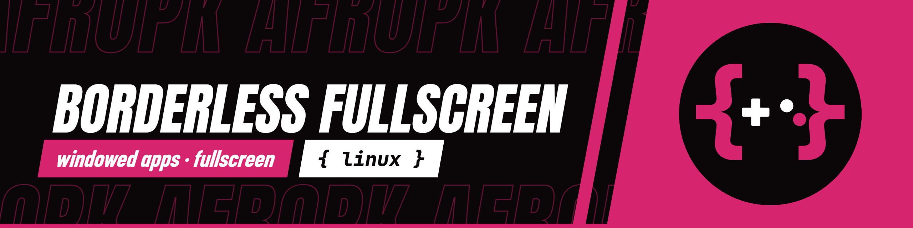

<p align="center">
  
</p>

<p align="center">
  
  
  
  
</p>

<p></p>

**`{ borderless-fullscreen }`**: a shell script that forces a windowed app into borderless fullscreen on Linux.

Some games only offer "windowed" or "exclusive fullscreen", and both are annoying on a multi-monitor desk. This puts the window you pick fullscreen without the mode switch, so alt-tab stays instant. It's the Linux take on the Borderless Gaming app from Windows.

> [!NOTE]
> Needs Xorg or Wayland tooling installed first — `xdotool` + `zenity` on Xorg, `wlr-randr` + `wmctrl` + `zenity` on Wayland. The installer asks which one you're on.

<p></p>

| Session | Packages |
|---|---|
| Xorg | `xdotool` · `zenity` |
| Wayland | `wlr-randr` · `wmctrl` · `zenity` |

<p></p>

**Needs:** `git` · `zenity` · `xdotool` or `wlr-randr` + `wmctrl`

```sh
# Debian/Ubuntu — Xorg
sudo apt-get install xdotool zenity
# Debian/Ubuntu — Wayland
sudo apt-get install wlr-randr wmctrl zenity
# Fedora — Xorg
sudo dnf install xdotool zenity
# Fedora — Wayland
sudo dnf install wlr-randr wmctrl zenity
# Arch — Xorg
pacman -Syu xdotool zenity
# Alpine — Xorg
apk add --upgrade xdotool zenity
```

1. Clone the repo and enter it: `git clone https://github.com/AfroPK/borderless-fullscreen.git && cd borderless-fullscreen`
2. `sudo chmod +x install.sh`
3. `sudo ./install.sh` and pick Wayland or Xorg.
4. It shows up in your application menu — launch it from there.

<p></p>

Start the app, pick the window you want, and it goes borderless fullscreen. To remove it, run `sudo ./uninstall.sh` from the cloned repo.

<p></p>

- Tested on Xorg and Wayland sessions; a few compositors handle window sizing differently.
- Inspired by [Borderless Gaming](https://github.com/Codeusa/Borderless-Gaming) on Windows.
- MIT licence.

<p align="center">
  
</p>
